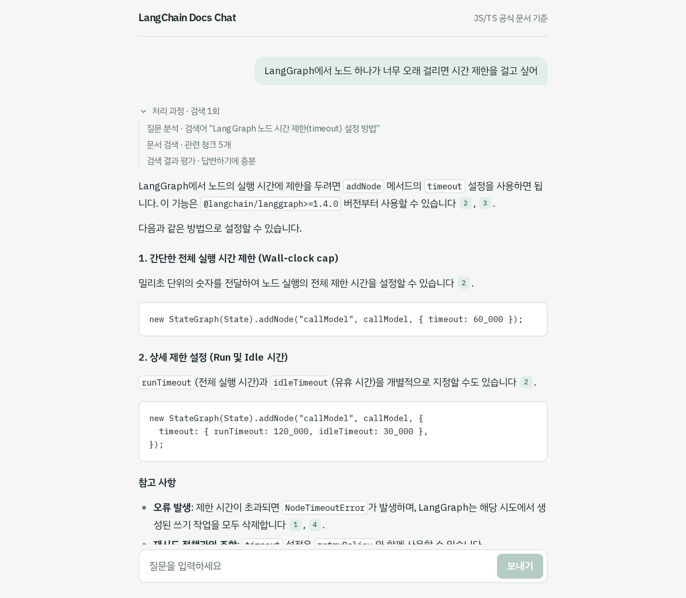
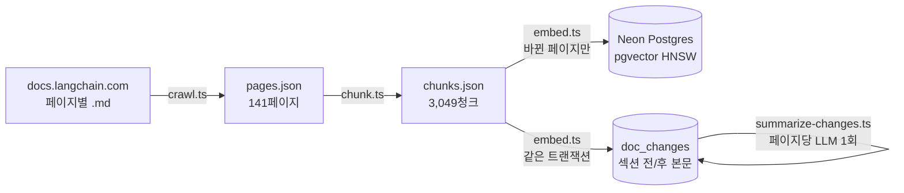
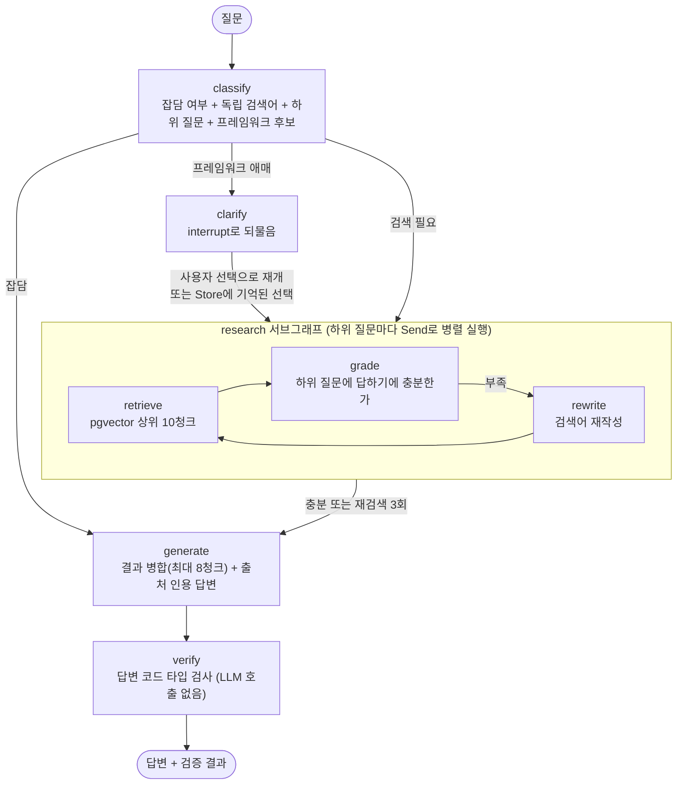

# pgvector-docs-chat

LangChain 공식 문서(JS/TS)를 근거로 답하는 RAG 챗봇입니다. LangGraph로 질문 분석 → 하위 질문별 병렬 검색 → 검색 결과 평가 → 재검색 → 답변 흐름을 만들고, 답변마다 참고한 문서를 번호로 인용합니다.

**데모**: https://pgvector-docs-chat.vercel.app/



## 주요 기능

- **근거 기반 답변**: 검색한 문서 안에서만 답하고, 근거로 쓴 문서를 `[n]`으로 인용합니다. 문서에 없으면 찾지 못했다고 답합니다.
- **자기 교정 검색 (Self-RAG)**: 검색 결과가 답하기에 부족하면 검색어를 문서 용어로 다시 써서 최대 3번까지 재검색합니다.
- **복합 질문 분해**: "checkpointer와 store는 뭐가 다르고 각각 언제 써?"처럼 여러 주제를 묻는 질문을 하위 질문으로 나눠 `Send`로 동시에 검색하고, 결과를 합쳐 한 번에 답합니다.
- **후속 질문 이해**: "그거 예시는?" 같은 질문을 대화 맥락을 반영한 독립 질문으로 바꿔 검색합니다.
- **애매한 질문 되묻기**: "메모리는 어떻게 써?"처럼 LangChain·LangGraph·Deep Agents 중 어느 것인지 알 수 없으면 그래프를 멈추고 선택지를 보여준 뒤, 고른 프레임워크 문서에서만 찾습니다. 고른 프레임워크는 브라우저별로 기억해 다음 대화부터는 되묻지 않고 적용하며, "변경"으로 다시 고를 수 있습니다.
- **대화 저장과 분기**: 대화가 서버에 저장돼 새로고침하거나 링크(`?thread=`)를 공유해도 이어집니다. 이전 질문을 고치면 그 시점부터 대화가 갈라지고, `‹ 1/2 ›`로 분기를 오갈 수 있습니다.
- **답변 코드 검증**: 답변의 TypeScript 코드를 실제 패키지 타입 정의로 타입 검사해, 존재하지 않는 API나 잘못된 인자를 찾아 경고합니다. 같은 에러가 참고한 문서 예시에도 있으면 "문서가 옛 API일 수 있음"으로 구분해 알립니다.
- **답변 피드백**: 답변마다 👍/👎와 사유(틀린 내용 / 관련 없는 문서 / 코드 오류 / 기타)를 받아 저장합니다. 👎 받은 답변은 질문·검색어·출처와 함께 평가셋 후보로 내보낼 수 있습니다.
- **문서 변경 추적**: 매주 공식 문서를 다시 수집해 바뀐 페이지만 반영하고, 페이지별 변경 내용을 요약해 "문서 변경" 화면에 보여줍니다. 이전 대화가 인용한 문서가 이후 바뀌었으면 출처 옆에 "이후 변경됨"으로 표시합니다.
- **처리 과정 표시**: 그래프의 각 단계(검색어, 찾은 청크 수, 평가 결과)를 실시간으로 보여주고, 답변이 시작되면 접어 둡니다. 하위 질문이 여러 개면 하위 질문별로 묶어 보여주고, 우측 패널에 그래프에서 지나온 경로를 표시합니다.
- **장애 대응**: 모델 실패 시 다른 모델로 자동 전환하고, 응답이 없으면 시간 제한 후 재시도 버튼을 보여줍니다.

## 아키텍처

### 데이터 파이프라인 (`scripts/`)



- **청킹**: MDX 태그를 정리한 뒤 헤딩 단위로 섹션을 나누고, 1500자 / 150자 overlap으로 분할합니다. 각 청크 앞에 `제목 > 섹션 > 하위 섹션` 경로를 붙여, 짧은 청크도 어느 문서의 어떤 내용인지 임베딩에 드러나게 했습니다.
- **임베딩**: `gemini-embedding-001` 1536차원 ([ADR-001](docs/adr/ADR-001-embedding-model.md))
- **증분 동기화**: DB에 저장된 청크 본문과 비교해 바뀐 페이지만 다시 임베딩합니다. 무료 티어 일일 한도(약 1,000건) 안에서 여러 날에 나눠 이어서 실행할 수 있습니다 ([ADR-002](docs/adr/ADR-002-incremental-sync.md)).
- **자동 동기화**: GitHub Actions가 매주 월요일 crawl → chunk → embed → 문서 예시 코드 에러 목록(`source-errors.json`) 갱신 → 변경 요약을 실행합니다. 에러 목록이 바뀌면 main에 커밋해 다시 배포합니다 ([`sync-docs.yml`](.github/workflows/sync-docs.yml)). 임베딩·LLM 한도를 챗봇과 나눠 쓰므로 1회 실행당 임베딩 800청크, 요약 30페이지까지만 처리하고 나머지는 다음 실행으로 넘깁니다.
- **변경 이력과 요약**: 청크를 교체하는 트랜잭션에서 바뀐 섹션의 전/후 본문을 `doc_changes`에 함께 기록합니다. 변경 전 본문은 교체 후 사라지므로 요약 성공 여부와 무관하게 먼저 남기고, 요약은 다음 단계에서 요약이 없는 이력부터 생성합니다 ([ADR-011](docs/adr/ADR-011-doc-change-history.md)). 3만 자가 넘는 섹션도 있어 전/후 공통 부분을 덜어내고 달라진 구간만 LLM에 넘깁니다.
- **변경 표시**: 저장된 대화를 불러올 때 답변 시점 이후에 기록된 출처 페이지의 이력을 찾아 "이후 변경됨"/"이후 삭제됨"을 표시하고, 요약이 있는 `/changes`의 해당 이력으로 연결합니다. 판정은 페이지 단위입니다.

### 질문 처리 (LangGraph, `apps/web/src/lib/graph`)



- `POST /api/chat`은 NDJSON 이벤트 스트림으로 응답합니다: 단계 진행(`step`), 하위 질문 분기 시작(`branch`), 답변 토큰(`token`), 출처(`sources`), 코드 검증 결과(`verify`), 실패(`error`).
- LLM 호출 횟수를 줄이려고 분류·검색어 작성·하위 질문 분해를 한 번에 처리하고, 검색 결과는 청크별이 아니라 묶어서 한 번에 평가합니다.

### 복합 질문 분해와 병렬 검색 (`Send`, 서브그래프)

- 단일 검색어로 여러 주제를 찾으면 한 주제의 청크가 상위 결과를 차지해 다른 주제의 근거가 빠집니다. 상위 청크 수를 늘리거나 섹션 중복을 제거하는 방법으로는 해결되지 않아, 검색어 자체를 주제별로 나눴습니다 ([ADR-007](docs/adr/ADR-007-compound-question-retrieval.md)).
- 분해는 별도 노드 없이 classify의 출력 필드(`subQueries`, 1~3개)로 받아 LLM 호출 수를 늘리지 않았습니다. 단일 주제 질문은 하위 질문 1개로 같은 경로를 탑니다.
- 검색 → 평가 → 재검색 반복을 `research` 서브그래프로 분리하고, 하위 질문마다 `Send`로 병렬 실행합니다. 평가와 재작성은 복합 질문 전체가 아니라 맡은 하위 질문을 기준으로 판단합니다.
- 각 분기의 결과는 누적 reducer로 모으고, generate가 하위 질문 순서대로 1위끼리·2위끼리 번갈아 합친 뒤 같은 섹션의 청크는 하나만 남겨 최대 8청크로 답합니다.
- 화면에는 `subgraphs: true` 스트림의 namespace로 분기를 구분해 하위 질문별 진행 단계를 보여줍니다.

### 답변 코드 검증 (TypeScript 컴파일러 API)

- 답변의 ` ```ts ` 코드 블록을 TypeScript 컴파일러 API로 타입 검사합니다. 빌드 전에 필요한 `.d.ts`만 한 폴더로 모아 Vercel 함수에 포함하고, 파싱한 타입 정의는 요청 간에 재사용합니다 ([`bundle-types.mjs`](apps/web/scripts/bundle-types.mjs)).
- 답변 코드는 발췌라 선언되지 않은 변수(TS2304) 같은 에러가 흔하므로, 에러 코드 10종 중 `@langchain/*`·`langchain`·`deepagents`에 선언된 API에서 난 에러만 판정합니다.
- 공식 문서 예시 자체도 7.3%(1,873블록 중 136블록)가 현재 타입 정의와 맞지 않습니다. 그래서 자동으로 고치지 않고, 같은 에러(에러 코드 + API 이름)가 출처 페이지의 예시에도 있는지에 따라 "답변이 잘못 만든 코드일 수 있음"과 "문서 예시도 맞지 않음"을 나눠 표시합니다 ([ADR-009](docs/adr/ADR-009-answer-code-verification.md)).
- 출처 비교는 청크가 아니라 페이지 단위로 미리 계산한 에러 목록([`source-errors.json`](apps/web/src/lib/source-errors.json))으로 합니다. 청크 경계에서 코드 블록이 잘려 청크로 비교하면 문서 예시의 에러를 놓치기 때문입니다.
- 출처 목록은 검사를 기다리지 않고 답변 직후 보내고, 검사 결과는 답변 메시지에 저장해 대화를 다시 불러와도 표시합니다.

### 애매한 질문 되묻기 (`interrupt`)

- 같은 주제(메모리, 스트리밍, human-in-the-loop, 서브에이전트 등)가 세 프레임워크 문서에 따로 있어, 어느 것인지 모르고 검색하면 섞인 답이 나옵니다.
- classify가 질문과 앞선 대화에 프레임워크 단서가 없을 때만 후보를 내고, 2개 이상이면 `clarify` 노드가 `interrupt()`로 그래프를 멈춥니다. 선택지는 체크포인트에 남아 새로고침해도 다시 보이고, 고르면 `Command({ resume })`로 이어서 실행합니다.
- 고른 프레임워크로 pgvector 검색 범위를 `source_url` 경로로 제한합니다. HNSW는 후보를 먼저 고른 뒤 거르므로 필터 검색에서만 iterative scan(pgvector 0.8)을 켜 결과가 모자라지 않게 했습니다.
- 필터는 사용자가 직접 고른 경우에만 겁니다. classify의 추측으로 거르면 잘못 분류됐을 때 정답 문서가 빠집니다.

### 프레임워크 선호 기억 (LangGraph Store)

- 체크포인트는 대화 단위라 새 대화를 시작하면 같은 되묻기에 다시 답해야 합니다. 그래서 사용자 단위 장기 기억으로 `PostgresStore`를 함께 연결했습니다 (`compile({ checkpointer, store })`).
- 로그인이 없으므로 `/api/chat`이 익명 UUID를 httpOnly 쿠키로 발급하고 `configurable.user_id`로 넘깁니다. namespace는 `["users", user_id]`입니다.
- `clarify`가 `interrupt()` 전에 Store를 조회해, 기억된 프레임워크가 이번 후보에 있으면 되묻지 않고 적용합니다. 후보에 없으면 그 질문에 맞지 않으므로 되묻고, "구분 없이 찾기"를 고르면 기억을 지웁니다.
- 기억을 적용한 답변에는 "기억된 선택 · 변경"을 표시합니다. "변경"은 질문 직전 체크포인트에서 기억을 무시하고 다시 실행해 되묻기를 받습니다. 재개 요청도 항상 기억을 무시합니다. 재개하면 `clarify`가 처음부터 다시 실행되므로, 그사이 다른 탭에서 생긴 기억이 사용자의 선택을 덮어쓰지 않게 하기 위해서입니다 ([ADR-012](docs/adr/ADR-012-framework-preference-memory.md)).

### 대화 저장과 분기 (`PostgresSaver`, time travel)

- 그래프를 `PostgresSaver` checkpointer로 컴파일해, 대화 상태가 노드 실행마다 Neon의 `langgraph` 스키마에 `thread_id`별로 저장됩니다. 클라이언트는 대화 기록 대신 `threadId`와 새 질문만 보냅니다.
- 질문 수정·재시도는 그 질문이 들어가기 직전 체크포인트에서 다시 실행(fork)해 형제 분기를 만듭니다. `GET /api/threads/[id]`가 `getStateHistory`로 체크포인트 트리를 읽어 지금 보이는 분기의 대화와 질문별 분기 목록을 돌려줍니다 ([`threads.ts`](apps/web/src/lib/threads.ts)).
- 답변 없이 실패한 실행은 재시도로 대체된 것이므로 분기 목록에서 숨깁니다.
- 체크포인트 전용 DB 계정은 자기 스키마만 쓸 수 있고 문서 테이블에는 접근할 수 없습니다 ([schema.md](docs/schema.md#대화-체크포인트-langgraph-스키마)).
- 답변 피드백은 같은 계정이 소유한 `feedback` 스키마에 체크포인트 id만 저장하고, 질문·검색어·출처는 필요할 때 그 체크포인트에서 읽습니다. 로그인 없는 공개 API이므로 존재하는 체크포인트에만 저장합니다 ([ADR-010](docs/adr/ADR-010-feedback-storage.md)).

## 검색 품질 평가

검색이 실제로 잘 되는지 확인하려고 평가셋을 만들어 측정했습니다 (`pnpm --filter scripts eval`).

- **평가셋** ([`scripts/eval/questions.json`](scripts/eval/questions.json)): 50문항. 한국어 36 / 영어 14, 유형은 API 이름 없이 상황만 설명하는 질문 31, API 이름 질문 12, 에러 메시지 질문 7
- **정답 기준**: 페이지가 아니라 **섹션 단위**. 같은 페이지의 다른 섹션이 나오면 틀린 것으로 봅니다.
- **지표**: Hit@k(상위 k개 청크에 정답 섹션이 있는 질문 비율), MRR(첫 정답 순위의 역수 평균). 챗봇은 상위 5개 청크를 답변 근거로 쓰므로 Hit@5가 핵심 지표입니다.

| | 문항 | Hit@1 | Hit@3 | Hit@5 | MRR |
|---|---:|---:|---:|---:|---:|
| 전체 | 50 | 78% | 94% | **98%** | 0.858 |
| 한국어 | 36 | 78% | 97% | 100% | 0.868 |
| 영어 | 14 | 79% | 86% | 93% | 0.832 |
| 상황 설명 | 31 | 74% | 94% | 100% | 0.844 |
| API 이름 | 12 | 92% | 100% | 100% | 0.944 |
| 에러 메시지 | 7 | 71% | 86% | 86% | 0.771 |

**결론과 판단**

- 한국어 질문으로 영어 문서를 검색해도 Hit@5 100%로, 벡터 검색만으로 충분했습니다.
- 상위 5개 밖으로 밀린 질문은 문서 전체에서 청크 하나에만 나오는 에러 이름(`ContextOverflowError`) 1건입니다. 드문 식별자에 약하다는 벡터 검색의 알려진 약점이 그대로 드러났습니다.
- 키워드 검색을 섞는 하이브리드 검색을 검토했지만, 개선 여지가 1문항뿐이라 지금은 도입하지 않았습니다 ([ADR-004](docs/adr/ADR-004-hybrid-search-deferred.md)).

**한계**: 질문과 정답을 개발 과정에서 직접 작성해 편향이 있을 수 있습니다. 처음 측정 후 놓친 질문을 검토하다 정답을 좁게 잡은 2문항을 발견해 정답 섹션을 추가했습니다(Hit@5 94% → 98%).

### 복합 질문 평가

여러 주제를 묻는 질문에서 주제마다 근거를 찾는지 확인하려고 따로 측정했습니다 (`pnpm --filter scripts eval-compound -- --graph`, [`compound-questions.json`](scripts/eval/compound-questions.json)).

- **평가셋**: 10개. 하위 주제 2개씩, 두 주제의 정답이 서로 다른 페이지에 있도록 구성 (예: "토큰 스트리밍 + 노드 단위 테스트")
- **지표**: 모든 하위 주제의 정답 섹션이 답변 컨텍스트에 들어간 질문 수, 하위 주제 단위로 들어간 수
- **비교 방식**: classify 1회의 출력으로 세 방식을 함께 재 모델 차이가 섞이지 않게 했고, `gemini-3.1-flash-lite`로 고정해 3회 측정했습니다 (2026-10-14).

| 방식 | 모든 하위 주제 (1차 / 2차 / 3차) | 하위 주제 |
|---|---:|---:|
| 분해 전: 검색어 1개, 상위 5청크 | 2 / 2 / 3 (10문항 중) | 11 / 12 / 12 (20개 중) |
| 분해: 하위 질문별 검색 후 병합 (검색만) | 8 / 8 / 7 | 18 / 18 / 17 |
| 분해 + 평가·재검색 (챗봇과 같은 그래프 경로) | **8 / 8 / 8** | **18 / 18 / 18** |

- 분해 후 모든 하위 주제를 찾은 질문이 2~3개에서 8개로 늘었습니다. 한 질문은 검색 결과 5개가 전부 한 섹션(`streaming#LLM tokens`)이었는데, 분해 후에는 두 주제의 섹션이 모두 들어갔습니다.
- 평가·재검색을 더해도 대부분 결과가 같았고, 3차에서 1문항만 재검색으로 누락을 보완했습니다. 3회 모두 놓친 하위 주제는 human-in-the-loop 1건입니다.
- 모델 실패가 없던 질문 기준으로 LLM 호출은 질문당 3회(classify 1 + 하위 질문별 grade 2), 재검색이 일어나면 5회였습니다.

**단일 주제 질문에 미치는 영향**: 검색 품질 평가셋 50문항을 같은 방식으로 돌려(`-- --single`, 검색만) 분해 전후를 비교했습니다.

| | 1차 | 2차 | 검색어 규칙 수정 후 |
|---|---:|---:|---:|
| 분해 전: 검색어 1개, 상위 5청크 | 43/50 | 43/50 | 47/50 |
| 분해 후: 하위 질문별 검색 후 병합 (최대 8청크) | 44/50 | 45/50 | **49/50** |
| 하위 질문 2개 이상으로 나뉜 질문 | 24/50 | 26/50 | 13/50 |

- 정답이 컨텍스트에 들어간 질문 수는 떨어지지 않았습니다. 문항별로는 양쪽으로 바뀐 경우가 있습니다.
- 단일 주제 질문의 절반가량이 2개 이상으로 나뉘었습니다. 13·15개는 프레임워크를 특정하지 않은 질문이 프레임워크별로 나뉜 것으로, 되물음에서 프레임워크 하나를 고르면 1개로 합칩니다. 나머지 11·11개는 같은 주제를 세부 측면으로 나눈 것으로, 하위 질문 수만큼 grade 호출이 늘어납니다.
- 검색어 규칙 수정 후 단일 질문을 평가·재검색까지 포함해 측정했습니다 (`-- --graph --single`, 2026-10-21, 1회). 정답이 들어간 질문은 48/50으로 검색만 측정한 값과 같았고, 15개가 2개 이상으로 나뉘었습니다(프레임워크별 2, 세부 측면 13). 모델 실패로 인한 재시도를 빼면 LLM 호출은 질문당 약 2.4회로, 나누지 않았을 때보다 grade 호출이 약 15% 늘었습니다. 증가 폭이 작고 정확도 손실이 없으며 나뉜 질문 중에는 실제로 두 대상을 묻는 질문도 있어, 세부 측면 분할은 억제하지 않았습니다.
- 1·2차의 분해 전 수치(43/50, 86%)가 앞의 Hit@5 98%보다 낮은 것은 검색어 차이 때문이었습니다. 검색 품질 평가는 질문 원문으로 검색하고, 챗봇은 classify가 다시 쓴 검색어로 검색합니다. classify가 혼자서 이해되는 질문에도 단서 없는 프레임워크 이름을 붙이고 증상 설명을 "~하는 방법"으로 바꿔 Troubleshooting 섹션을 놓쳤습니다.
- classify에 "사용자 표현을 유지하고, 단서 없이 프레임워크 이름을 붙이지 않는다" 규칙을 추가한 뒤(2026-10-16, 1회) 분해 후 49/50으로 원문 검색 수준을 회복했고, 단일 주제 질문의 분할도 절반가량에서 13개로 줄었습니다. 같은 조건에서 복합 질문(그래프 경유)은 8/10으로 유지되었습니다 ([ADR-008](docs/adr/ADR-008-search-query-keeps-user-wording.md)).

### 되묻기 판단 평가

되물어야 할 때만 묻는지 확인하려고 classify만 따로 실행해 측정했습니다 (`pnpm --filter scripts eval-clarify`, [`clarify-questions.json`](scripts/eval/clarify-questions.json)).

- **평가셋**: 49개. 어느 프레임워크인지 알 수 없는 질문 22 (예: "메모리는 어떻게 써?"), 프레임워크·API 이름·비교·에러 메시지로 알 수 있는 질문 21, 앞선 대화에서 프레임워크를 밝힌 후속 질문 6
- **지표**: recall은 되물어야 할 질문 중 실제로 되물은 비율, precision은 되물은 질문 중 되물어야 했던 비율. 불필요하게 되물으면 사용자를 귀찮게 하므로 precision을 우선해 프롬프트에 "확실하지 않으면 묻지 않는다"를 넣었습니다. 이후 검색어 규칙 수정에서는 검색 개선 폭이 커서 불필요한 되묻기 1~2건을 감수했습니다 ([ADR-008](docs/adr/ADR-008-search-query-keeps-user-wording.md)).
- **모델**: 자동 전환이 섞이면 결과를 비교할 수 없어 `gemini-3.1-flash-lite`로 고정해 2회 측정했습니다.

| | 정확도 | recall | precision |
|---|---:|---:|---:|
| 1차 | 46/49 | 19/22 | **19/19** |
| 2차 | 45/49 | 18/22 | **18/18** |
| 검색어 규칙 수정 후 1차 | 46/49 | **21/22** | 21/23 |
| 검색어 규칙 수정 후 2차 | 47/49 | **22/22** | 22/24 |

- 수정 전에는 불필요하게 되물은 경우가 없었고, 앞선 대화로 프레임워크를 알 수 있는 후속 질문도 되묻지 않았습니다.
- 수정 후에는 recall이 오른 대신 "임베딩 차원은 얼마로 하는 게 좋아?" 등 1~2건을 불필요하게 되물었습니다. 이 경우에도 "구분 없이 찾기"를 고르면 수정 전과 같은 방식으로 답합니다.
- classify에 하위 질문 출력을 추가한 직후 recall이 19/22에서 14~16/22로 떨어졌습니다. 모델이 질문 주제만 보고 프레임워크 후보를 1개로 단정했기 때문이며, "후보를 1개만 내지 않는다" 규칙을 추가해 추가 전 수준으로 회복했습니다 ([ADR-007](docs/adr/ADR-007-compound-question-retrieval.md)).
- 놓친 질문은 지금처럼 전체 문서에서 검색해 답하므로 이전보다 나빠지지는 않습니다.
- 로컬 모델 `qwen2.5:7b`(Ollama)는 이전 23문항 평가셋에서 recall 1/10으로 거의 되묻지 않아, 이 기능은 Gemini에서만 의미가 있습니다.

### 답변 코드 검증 평가

구현 방법을 묻는 질문에서 답변 코드의 API 에러와 출처 비교 분류를 측정했습니다 (`pnpm --filter scripts eval-verify`, 검색 품질 평가셋 중 20문항, `gemini-3.1-flash-lite`, 2026-10-18).

| 항목 | 결과 |
|---|---:|
| TS 코드가 있는 답변 | 20/20 |
| 판정 에러가 있는 답변 | 2/20 |
| 출처에도 있음 / 출처에 없음 | 2 / 0 |
| 검사 시간 중앙값 | 66ms |

- 판정된 2건(`state.authenticated`, `trimMessages`의 `tokenCounter` 누락)은 모두 실제 타입 에러였고, 출처 문서 예시를 그대로 옮긴 코드였습니다. 답변이 스스로 만든 API 에러는 이번 표본에서 나오지 않았습니다.
- 처음에는 출처 청크의 코드와 비교해 두 건 모두 "출처에 없음"으로 잘못 분류했습니다. 코드가 든 청크의 상당수(3,049청크 중 929개)에서 코드 블록이 청크 경계에서 잘려 있었기 때문이며, 페이지 단위 비교로 바꾼 뒤 같은 답변이 바르게 분류되었습니다.

## 운영 이슈와 대응

모두 무료 티어로 운영하면서 겪은 문제입니다.

| 문제 | 대응 |
|---|---|
| 임베딩 일일 한도(약 1,000건)로 3천 청크를 하루에 못 넣음 | 바뀐 페이지만 임베딩하는 증분 동기화로 4일에 나눠 적재 ([ADR-002](docs/adr/ADR-002-incremental-sync.md)) |
| 자동 동기화가 분당 한도 429에서 즉시 재시도를 반복해 실패 | 응답의 `retryDelay`가 0초로 와도 최소 60초 대기 후 재시도 ([`embedding.ts`](apps/web/src/lib/embedding.ts)) |
| 동기화가 일일 임베딩 한도를 소진하면 챗봇의 질문 임베딩도 실패 | 1회 실행당 임베딩 800청크 상한, 나머지는 다음 실행에서 이어서 처리 |
| `gemini-3.8-flash` 무료 티어가 하루 20요청이라 질문 몇 개면 429 | `gemini-3.5-flash` → `gemini-3.1-flash-lite` 순으로 자동 전환 ([`llm.ts`](apps/web/src/lib/llm.ts)) |
| 모델이 에러 없이 응답을 멈춰 화면이 계속 대기 | 호출마다 시간 제한(15초/30초)을 둬 다음 모델로 전환, 실패한 모델은 1분간 건너뜀. 그래프 전체도 120초 제한 |
| 질문을 수정해 분기하면 새 분기가 다른 분기의 메시지를 읽음 | JS `PostgresSaver`가 채널 버전을 정수로 1씩 올려 두 분기의 버전이 겹치고, `checkpoint_blobs`의 `ON CONFLICT DO NOTHING`으로 새 값이 버려지는 문제를 체크포인트 덤프로 확인. Python 구현처럼 버전에 난수 접미사를 붙이도록 `getNextVersion`을 재정의 ([`checkpointer.ts`](apps/web/src/lib/db/checkpointer.ts)) |
| 공식 문서 예시의 7.3%가 현재 패키지 타입 정의와 맞지 않음 (옛 API, 문서·타입 불일치) | 답변 코드 검증에서 자동 수정 대신, 문서에도 있는 에러는 "문서 예시도 맞지 않음"으로 구분해 안내 ([ADR-009](docs/adr/ADR-009-answer-code-verification.md)) |
| 스트리밍 도중 실패하면 HTTP 상태 코드로 알릴 수 없음 | `error` 이벤트로 원인별 안내(한도 초과 / 시간 초과 / 기타), 마지막 답변에 재시도 버튼 |

## 기술 스택

- **앱**: Next.js 14 (App Router), React, Tailwind CSS
- **AI**: LangGraph, LangChain, Gemini (LLM: 3.8 / 3.5 Flash, 임베딩: `gemini-embedding-001`), 로컬 개발 시 Ollama
- **DB**: PostgreSQL + pgvector (Neon), HNSW 인덱스, 코사인 거리
- **배포**: Vercel
- **모노레포**: pnpm workspace (`apps/web`, `scripts`)

## 프로젝트 구조

```
apps/web/src/
├── app/
│   ├── page.tsx              # 채팅 UI (스트림 파싱, 처리 과정, 재시도, 질문 수정·분기 전환)
│   ├── changes/page.tsx      # 최근 문서 변경 목록
│   ├── api/chat/route.ts     # 그래프 실행 → NDJSON 이벤트 스트림
│   ├── api/threads/[id]/route.ts  # 저장된 대화 불러오기
│   └── api/feedback/route.ts # 답변 피드백 저장
├── components/AnswerMarkdown.tsx  # 마크다운 + [n] 인용 배지
├── components/GraphPanel.tsx      # 처리 과정 그래프 (지나온 경로·병렬 분기 표시)
└── lib/
    ├── graph/                # LangGraph 상태·노드·그래프 정의 (research.ts: 검색 서브그래프와 결과 병합)
    ├── db/pgvector.ts        # 유사도 검색 (읽기 전용 계정)
    ├── db/checkpointer.ts    # 대화 체크포인트 저장 (PostgresSaver)
    ├── db/store.ts           # 사용자별 기억 저장 (PostgresStore)
    ├── threads.ts            # 체크포인트 트리 → 화면용 대화·분기 목록
    ├── feedback.ts           # 답변 피드백 저장·조회
    ├── doc-changes.ts        # 문서 변경 이력 조회
    ├── verify.ts             # 답변 코드 타입 검사, 출처 비교 (source-errors.json: 페이지별 문서 예시 에러)
    ├── embedding.ts          # Gemini 임베딩 (저장·검색 공용)
    └── llm.ts                # LLM 호출, 모델 자동 전환
scripts/
├── crawl.ts / chunk.ts / embed.ts  # 데이터 파이프라인 (embed.ts: 변경 이력 기록 포함)
├── summarize-changes.ts            # 문서 변경 이력 요약
├── eval.ts, eval/questions.json    # 검색 품질 평가
├── eval-clarify.ts, eval/clarify-questions.json  # 되묻기 판단 평가
├── eval-compound.ts, eval/compound-questions.json  # 복합 질문 평가 (--single: 단일 질문 비교)
├── verify-docs.ts                  # 문서 예시 코드 타입 검사 (--write: source-errors.json 생성)
├── eval-verify.ts                  # 답변 코드 검증 평가
├── feedback-export.ts              # 👎 답변을 평가셋 후보 JSON으로 출력
└── setup-checkpointer.ts / setup-store.ts / setup-feedback.ts / cleanup-threads.ts  # 체크포인트·Store·피드백 테이블 생성, 오래된 대화 정리
.github/workflows/sync-docs.yml    # 주간 문서 동기화
docs/
├── schema.md                 # DB 스키마
└── adr/                      # 설계 결정 기록
```

## 로컬 실행

**준비물**: Node.js 24, pnpm, Gemini API 키, pgvector를 쓸 수 있는 Postgres(Neon 등)

```bash
pnpm install
cp apps/web/.env.example apps/web/.env.local   # 값 채우기
```

DB에 [`docs/schema.md`](docs/schema.md)의 테이블과 인덱스를 만들고, 계정 3개(임베딩 저장용, 챗봇 검색용 읽기 전용, 대화 체크포인트용)를 준비합니다. 체크포인트·Store·피드백 테이블은 schema.md의 절차대로 `pnpm --filter scripts setup-checkpointer`, `setup-store`, `setup-feedback`으로 만듭니다.

```bash
# 데이터 적재 (data/ 아래에 중간 결과 저장)
pnpm --filter scripts crawl
pnpm --filter scripts chunk
pnpm --filter scripts embed    # 무료 한도에 걸리면 멈춤. 다음 날 다시 실행하면 이어서 진행
pnpm --filter scripts summarize-changes   # 요약이 없는 변경 이력 요약 (1회 30페이지)

# 검색 품질 평가
pnpm --filter scripts eval

# 되묻기 판단 평가 (질문마다 LLM 1회, Gemini는 분당 한도 때문에 13초 간격)
pnpm --filter scripts eval-clarify

# 복합 질문 평가 (--graph: grade·rewrite 포함, --single: 단일 질문 평가셋으로 비교)
pnpm --filter scripts eval-compound -- --graph

# 문서 예시 코드 타입 검사 (--write: 출처 비교용 페이지별 에러 목록 갱신, 문서를 다시 수집한 뒤 실행)
pnpm --filter scripts verify-docs -- --write

# 답변 코드 검증 평가 (질문당 LLM 3~10회)
pnpm --filter scripts eval-verify

# 👎 피드백을 평가셋 후보로 내보내기
pnpm --filter scripts feedback-export -- --out candidates.json

# 30일 넘게 활동이 없는 대화 정리 (기본은 대상만 출력)
pnpm --filter scripts cleanup-threads -- --delete

# 챗봇 실행 (http://localhost:3000)
pnpm dev
```

> Windows와 WSL을 오가며 쓴다면 `pnpm install`은 Windows에서 하세요. 두 OS의 네이티브 바이너리를 함께 받도록 설정돼 있지만(`pnpm-workspace.yaml`), WSL이 만든 심볼릭 링크는 Windows에서 읽지 못합니다. WSL의 개발 서버는 `/mnt/` 아래 파일 변경을 감지하지 못하므로 코드를 고친 뒤 다시 시작해야 합니다.

### 환경 변수 (`apps/web/.env.local`)

| 변수 | 설명 |
|---|---|
| `LLM_PROVIDER` | `gemini`(기본) 또는 `ollama`. 임베딩은 항상 Gemini |
| `GEMINI_API_KEY` | Gemini API 키 |
| `GEMINI_MODEL` | 첫 번째로 시도할 LLM (기본 `gemini-3.8-flash`). 실패하면 자동 전환 |
| `OLLAMA_BASE_URL`, `OLLAMA_MODEL` | `LLM_PROVIDER=ollama`일 때만 사용 |
| `EMBED_DATABASE_URL` | 쓰기 계정. `scripts/embed.ts`, `summarize-changes.ts`에서만 사용 |
| `DATABASE_URL` | 읽기 전용 계정. 챗봇 검색·문서 변경 표시와 평가에서 사용 |
| `CHECKPOINT_DATABASE_URL` | 대화 체크포인트 계정. `langgraph` 스키마만 쓰기 가능 |

## 문서

- [DB 스키마](docs/schema.md)
- [ADR-001: 임베딩 모델과 차원](docs/adr/ADR-001-embedding-model.md)
- [ADR-002: 증분 동기화](docs/adr/ADR-002-incremental-sync.md)
- [ADR-003: LLM 실패 시 후순위 모델로 즉시 전환](docs/adr/ADR-003-llm-model-fallback.md)
- [ADR-004: 하이브리드 검색 도입 보류](docs/adr/ADR-004-hybrid-search-deferred.md)
- [ADR-005: 대화 상태 서버 저장과 분기 직접 구현](docs/adr/ADR-005-conversation-persistence.md)
- [ADR-006: 대상 프레임워크 확인 후 검색 범위 제한](docs/adr/ADR-006-framework-clarification.md)
- [ADR-007: 복합 질문 분해 후 개별 검색](docs/adr/ADR-007-compound-question-retrieval.md)
- [ADR-008: classify 검색어는 사용자 표현 유지](docs/adr/ADR-008-search-query-keeps-user-wording.md)
- [ADR-009: 답변 코드 검증 결과는 출처 비교 경고로 표시](docs/adr/ADR-009-answer-code-verification.md)
- [ADR-010: 답변 피드백 저장 위치](docs/adr/ADR-010-feedback-storage.md)
- [ADR-011: 문서 변경 이력과 요약 생성 방식](docs/adr/ADR-011-doc-change-history.md)
- [ADR-012: 프레임워크 선호 기억과 자동 적용](docs/adr/ADR-012-framework-preference-memory.md)
- [개발 계획과 진행 상황](plan.md)
